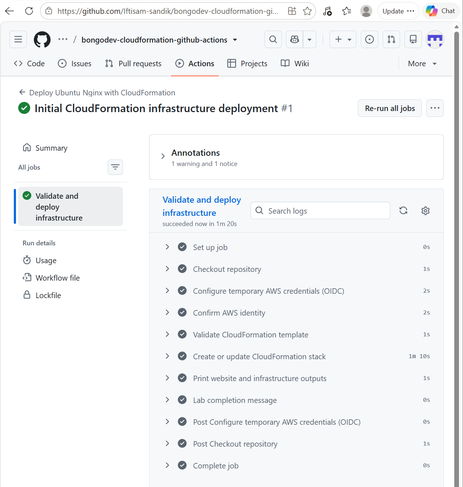
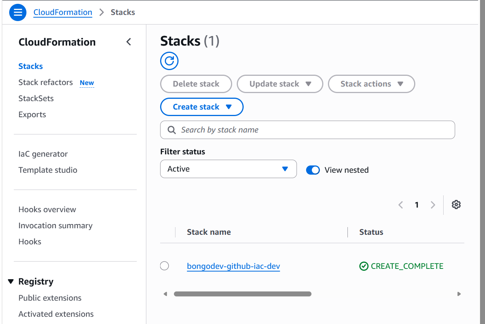
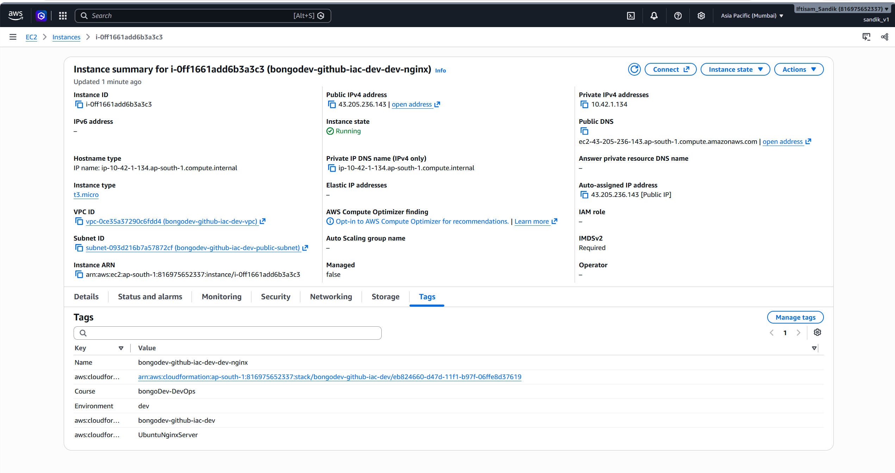
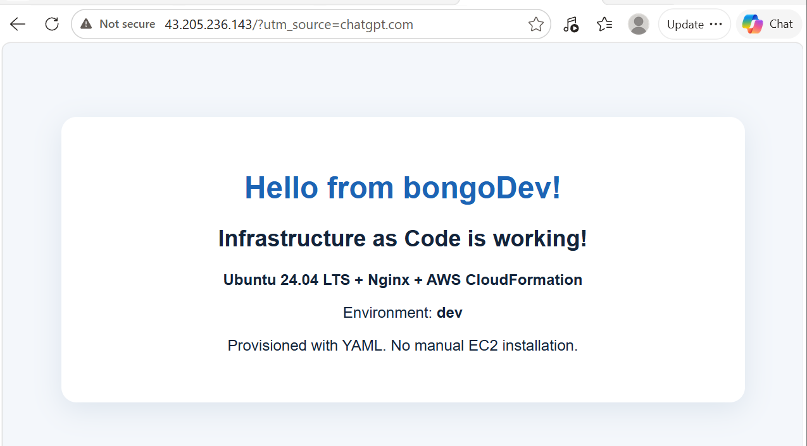
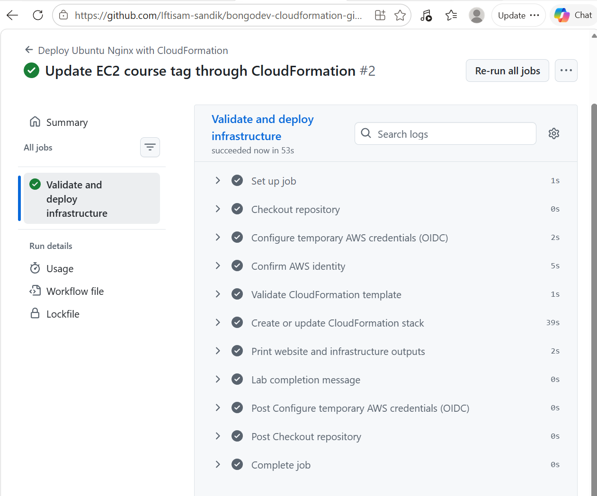
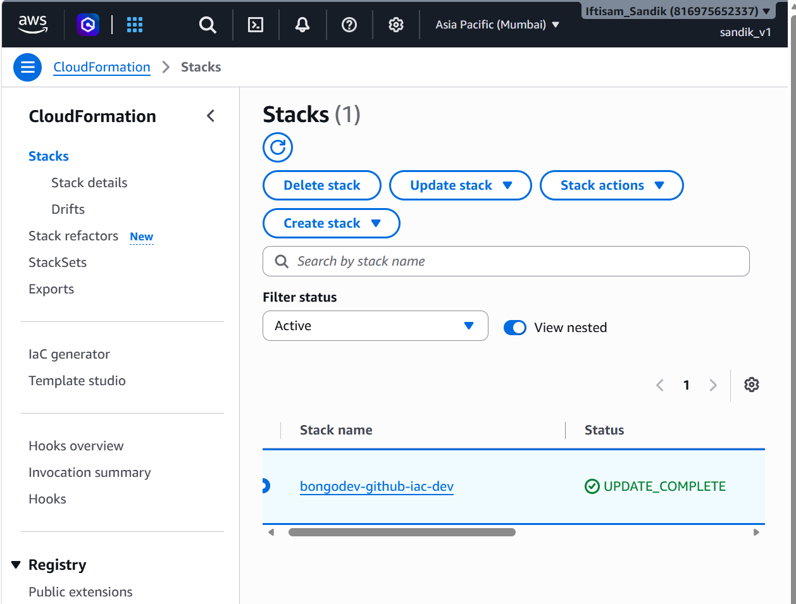
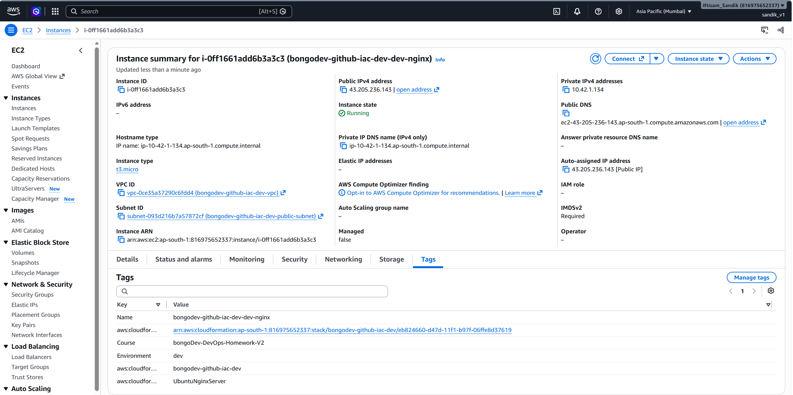
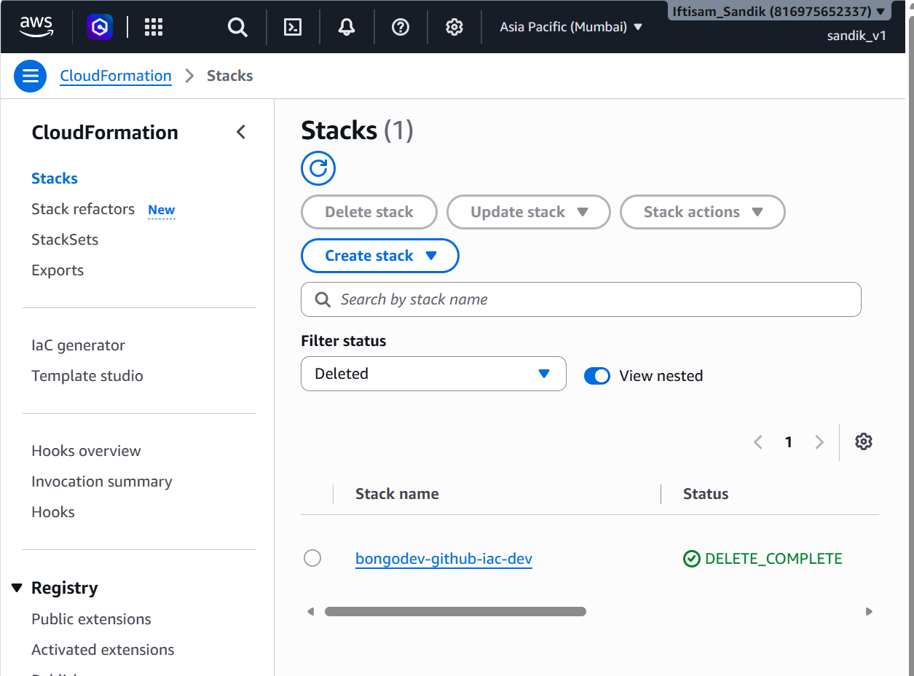

# AWS CloudFormation Deployment with GitHub Actions

### bongoDev — DevOps Homework

## 1. Project Overview

This is my bongoDev homework project where I practiced deploying AWS infrastructure automatically using **GitHub Actions and AWS CloudFormation**.

The main goal was to deploy an Ubuntu EC2 instance with Nginx without manually creating the resources from the AWS Console.

For this homework, I used the provided CloudFormation template and GitHub Actions workflow. I configured the GitHub repository, AWS IAM permissions, and OIDC authentication to make the deployment work.

I also tested whether a second Git push could update the existing infrastructure instead of creating everything again.

## 2. Tools and Services Used

| Tool / Service | Purpose |
|---|---|
| AWS CloudFormation | Create and update AWS resources using YAML |
| GitHub Actions | Automatically run the deployment workflow |
| AWS IAM & OIDC | Allow GitHub Actions to access AWS securely |
| Amazon EC2 | Run the Ubuntu server |
| Nginx | Host the demo webpage |
| Git & GitHub | Store the files and track changes |
| VS Code | Edit the project files |

**AWS Region:** `ap-south-1` (Mumbai)

## 3. How the Project Works

The deployment process follows this flow:

```text
VS Code (Local PC)
       |
       | Git Push
       v
GitHub Repository
       |
       v
GitHub Actions
       |
       | AWS Authentication (OIDC)
       | CloudFormation Template Validation
       v
AWS CloudFormation
       |
       | Create / Update Stack
       v
AWS Resources
       |
       +--- VPC and Public Subnet
       +--- Internet Gateway and Routing
       +--- Security Group
       +--- Ubuntu EC2 Instance
                    |
                    v
               Nginx Website
```

When I pushed the CloudFormation YAML file to the `main` branch, GitHub Actions automatically started the workflow.

The workflow first authenticated with AWS using OIDC, validated the CloudFormation template, and then deployed the stack.

CloudFormation created the required AWS resources. After the EC2 instance launched, the User Data script installed Nginx and configured the webpage.

## 4. AWS Infrastructure

The CloudFormation template creates the following resources:

| Resource | Configuration |
|---|---|
| VPC | `10.42.0.0/16` |
| Public Subnet | `10.42.1.0/24` |
| Internet Gateway | Provides internet connectivity |
| Route Table | Routes traffic to the Internet Gateway |
| Security Group | Allows HTTP traffic on port 80 |
| EC2 Instance | Ubuntu 24.04 LTS, `t3.micro` |
| Web Server | Nginx |

The EC2 User Data script automatically installs and starts Nginx, so I did not need to connect to the server and install it manually.

---

## 5. Implementation

### Step 1 — GitHub and AWS Setup

I started by creating an empty GitHub repository and preparing the provided project files in VS Code.

For AWS authentication, I used the existing GitHub OIDC Provider in my AWS account.

Then I created an IAM policy and IAM role for the deployment. I also configured the role's Trust Policy so that my GitHub repository could assume the role from the `main` branch.

After that, I added two GitHub repository variables:

- `AWS_ROLE_ARN`
- `AWS_REGION`

This allowed GitHub Actions to connect to AWS without storing permanent access keys.

### Step 2 — First Deployment

After completing the configuration, I made my first Git commit and pushed the files to GitHub.

The push triggered GitHub Actions automatically. The workflow validated the CloudFormation template and deployed the infrastructure successfully.



I then checked AWS CloudFormation and found that the stack `bongodev-github-iac-dev` was created with the status `CREATE_COMPLETE`.



Next, I checked the EC2 Console. The Ubuntu instance was running with the expected instance type and the original `Course` tag.



Finally, I opened the EC2 public IP address in my browser and confirmed that the Nginx demo webpage was working.



**First Commit:** [5c920c0](https://github.com/Iftisam-sandik/bongodev-cloudformation-github-actions/commit/5c920c0)

### Step 3 — Updating the Existing Infrastructure

For the second deployment, I made a small change in `cloudformation.yaml`.

I changed the EC2 `Course` tag:

**Previous value:**

```yaml
Value: bongoDev-DevOps
```

**Updated value:**

```yaml
Value: bongoDev-DevOps-Homework-V2
```

After committing and pushing the change, GitHub Actions automatically ran the workflow for the second time.



This time, CloudFormation updated the existing stack instead of creating a new one. I checked the CloudFormation Console and found the status `UPDATE_COMPLETE`.



I also checked the EC2 instance and confirmed that the new `Course` tag was applied to the same running instance.



**Second Commit:** [a02ad2a](https://github.com/Iftisam-sandik/bongodev-cloudformation-github-actions/commit/a02ad2a)

---

## 6. Deployment Results

| Test | Result |
|---|---|
| First GitHub Actions Workflow | Successful |
| CloudFormation Stack Creation | `CREATE_COMPLETE` |
| EC2 Instance | Running |
| Nginx Website | Working |
| Second GitHub Actions Workflow | Successful |
| CloudFormation Stack Update | `UPDATE_COMPLETE` |
| EC2 Course Tag Update | Successful |
| Stack Cleanup | `DELETE_COMPLETE` |

Both deployment runs completed successfully.

---

## 7. Cleanup

After completing the deployment tests and collecting the screenshots, I deleted the CloudFormation stack using AWS CLI.

```bash
aws cloudformation delete-stack \
  --stack-name bongodev-github-iac-dev \
  --region ap-south-1
```

I checked CloudFormation again and confirmed that the stack status was `DELETE_COMPLETE`.



I also deleted the IAM role and IAM policy that were created specifically for this homework.

The AWS resources created for the demo have been removed, so the Nginx website is no longer running.

---

## 8. What I Learned

This homework helped me understand how GitHub Actions and CloudFormation work together.

Before doing this project, I was more familiar with creating AWS resources manually. Here, I practiced deploying infrastructure through Git pushes and checking the results in AWS.

I also learned how OIDC authentication works with an IAM role and how CloudFormation can update an existing resource without creating a new one.

The most useful part for me was seeing both the initial deployment and the second update work automatically through GitHub Actions.

---

## 9. Additional Files

For more details about the homework:

- [Original Homework Instructions](Homework-Instructions.md) — The original homework requirements and step-by-step instructions provided for this assignment.
- [Homework Submission Report](Homework-Submission-Report.md) — Deployment results, verification, and cleanup details.
- [Homework Questions and Answers](Homework-Questions-and-Answers.md) — Answers to the seven homework questions.
- [Screenshots](ScreenShots/) — All screenshots collected during the project.

---

**Project Status:** Completed and cleaned up.
